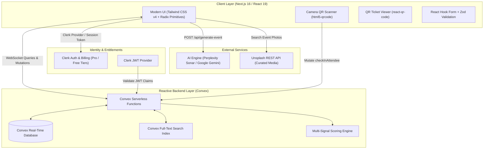
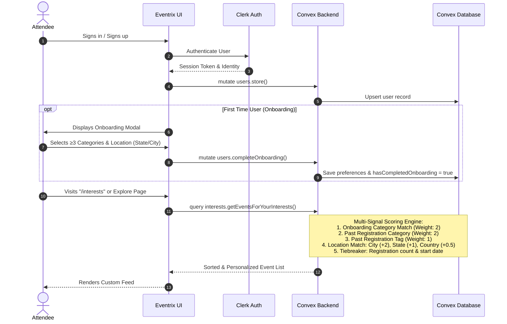
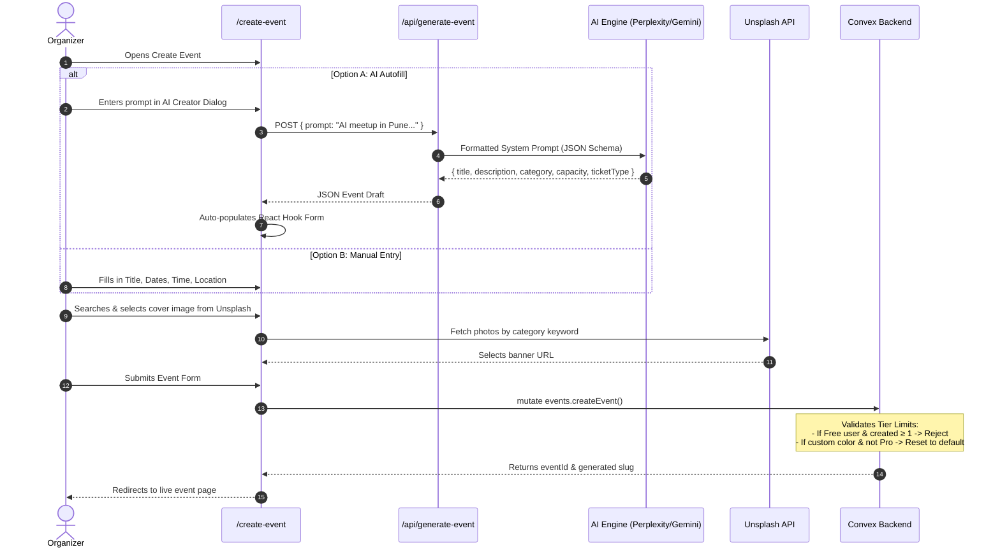
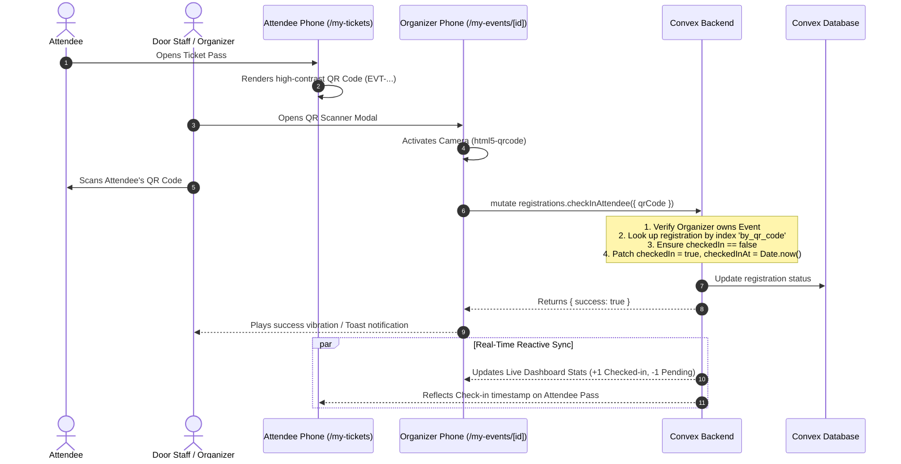
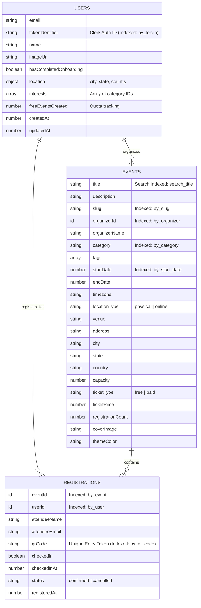

# 🎟️ Eventrix — Modern Real-Time Event Management & Ticketing Platform

> **Discover, create, and manage memorable events with real-time syncing, AI-powered generation, personalized recommendations, and in-browser QR ticketing.**


---

## 📖 Table of Contents

- [Overview](#-overview)
- [System Architecture](#-system-architecture)
- [Why These Technologies? Role in the Flow](#-why-these-technologies-role-in-the-flow)
- [Core Workflows & User Journeys](#-core-workflows--user-journeys)
  - [1. Attendee Journey & Recommendation Engine](#1-attendee-journey--intelligent-recommendation-engine)
  - [2. Organizer Journey & AI Event Creation](#2-organizer-journey--ai-event-creation)
  - [3. QR Admission & Real-Time Check-In Flow](#3-qr-admission--real-time-check-in-flow)
- [Database Schema (Convex Data Model)](#-database-schema-convex-data-model)
- [Key Features](#-key-features)
- [Project Directory Structure](#-project-directory-structure)
- [Environment Variables & Configuration](#-environment-variables--configuration)
- [Getting Started](#-getting-started)
- [Production & GitHub Deployment Guide](#-production--github-deployment-guide)

---

## 🌟 Overview

**Eventrix** is an end-to-end, real-time event discovery, management, and admissions ecosystem built with **Next.js 16**, **React 19**, **Convex**, and **Clerk**. It bridges the gap between event organizers and attendees with delightful user experiences:

- **For Attendees:** Intelligent onboarding, location-aware event discovery, multi-signal personalized recommendations, instant registration, and mobile-ready QR digital tickets.
- **For Organizers:** AI-assisted event creation (from a single sentence prompt), real-time attendee management, built-in camera QR code check-in scanner, live dashboard analytics, and CSV export.
- **For Business / Monetization:** Tiered subscription model (Free vs. Pro) with quota enforcement, custom branding privileges, and Clerk Pricing Tables.

---

## 🏗️ System Architecture

Eventrix utilizes a reactive, serverless architecture where state changes in the database are pushed automatically to connected web clients via persistent WebSocket subscriptions (Convex), eliminating traditional polling and cache invalidation bottlenecks.



---

## 💡 Why These Technologies? Role in the Flow

Every technology in the Eventrix stack was deliberately chosen to solve specific real-time, UX, and operational challenges:

### 1. Next.js 16 (App Router) & React 19
- **Why it was chosen:** Provides industry-leading hybrid rendering, streaming server components, built-in SEO optimization, and clean file-based routing with route groups `(auth)`, `(main)`, and `(public)`.
- **Role in the Flow:**
  - Serves static and dynamic metadata for public event pages (`/events/[slug]`) to guarantee search engine indexability and social sharing previews.
  - Route handlers (`app/api/generate-event/route.js`) securely proxy AI completions without exposing secret API keys to the browser.
  - Granular route separation protects sensitive routes (`/create-event`, `/my-events`, `/my-tickets`) while keeping discovery open to visitors.

### 2. Convex (Reactive Serverless Backend & Database)
- **Why it was chosen:** Traditional databases (PostgreSQL/MySQL) require custom WebSocket layers or polling solutions (like Pusher or socket.io) to reflect ticket purchases and check-ins in real time. Convex replaces the entire backend and ORM with transactional, reactive JavaScript TypeScript functions backed by a real-time database.
- **Role in the Flow:**
  - **Live Syncing:** When an attendee checks in via QR code, the organizer's dashboard statistics (checked-in count, check-in rate, pending attendees) update **instantly** on the screen without a page refresh.
  - **Atomic Transactions:** Event capacity increments/decrements and duplicate registration checks execute atomically, preventing overselling.
  - **Server-Side Quota Enforcement:** Server-side functions enforce that Free users cannot exceed their 1-event quota or apply custom Pro theme colors.

### 3. Clerk (Authentication, User Profiles & Subscriptions)
- **Why it was chosen:** Turnkey identity platform supporting OAuth (Google, GitHub, email passcodes) with native support for user metadata, role-based access control, and built-in subscription management.
- **Role in the Flow:**
  - Handles authentication across modal and redirect flows.
  - Integrates seamlessly with Convex via JWT issuer verification (`convex/auth.config.js`), allowing Convex functions to securely identify the caller via `ctx.auth.getUserIdentity()`.
  - Powering the Pro tier: `useAuth().has({ plan: "pro" })` conditionally reveals Pro badges and triggers Clerk's `<PricingTable />` for self-serve upgrades.

### 4. AI Engine (Perplexity Sonar & Google Gemini 2.0)
- **Why it was chosen:** Creating event titles, engaging descriptions, capacity suggestions, and category tags can be intimidating for organizers. Modern LLMs transform rough 1-sentence ideas into comprehensive event listings.
- **Role in the Flow:**
  - In `AIEventCreator`, the organizer inputs: *"A hands-on workshop in Bengaluru for React 19 Actions and Suspense"*.
  - The API route prompts the LLM with strict JSON schema rules (no markdown, single-line strings, constrained category enums).
  - The structured JSON response auto-fills the entire React Hook Form, saving organizers 5–10 minutes of manual data entry.

### 5. HTML5-QRCode & React-QR-Code
- **Why it was chosen:** Eliminates the need for native iOS/Android organizer apps or external laser barcode hardware.
- **Role in the Flow:**
  - **Attendee:** `react-qr-code` generates high-contrast SVG QR codes for the attendee's unique entry pass (`EVT-<timestamp>-<hash>`).
  - **Organizer:** `html5-qrcode` accesses the device camera (including mobile rear environment cameras with torch support) right inside the web browser to scan passes at the door with sub-second validation.

### 6. Tailwind CSS v4, Radix UI & Lucide Icons
- **Why it was chosen:** Tailwind CSS v4 delivers lightning-fast compilation, modern CSS theme variables, and glassmorphic aesthetics. Radix UI provides unstyled, accessible primitives (dialogs, popovers, select dropdowns, tabs).
- **Role in the Flow:**
  - Dynamic event card theming: Calculates harmonious card background shades using hex manipulation (`darkenColor`) based on the event's custom branding color.
  - Accessible dialog modals for onboarding, QR ticket presentation, AI prompts, and camera scanner viewports.

### 7. Country-State-City & Unsplash API
- **Why it was chosen:** Eliminates typos and inconsistencies in event locations and provides high-resolution cover photos with zero manual image uploads.
- **Role in the Flow:**
  - Country-State-City powers cascading dropdowns (Indian States $\rightarrow$ Cities) for onboarding and event creation.
  - Unsplash API allows organizers to search and select curated banner photography in one click.

---

## 🔄 Core Workflows & User Journeys

### 1. Attendee Journey & Intelligent Recommendation Engine



---

### 2. Organizer Journey & AI Event Creation



---

### 3. QR Admission & Real-Time Check-In Flow



---

## 🗄️ Database Schema (Convex Data Model)

Eventrix defines its data schema with runtime type-checking via `convex/values`:



### Key Convex Indexes

- **`users.by_token`**: O(1) identity lookup on every authenticated mutation/query.
- **`events.by_slug`**: Instant lookup for public marketing pages (`/events/:slug`).
- **`events.by_start_date`**: Chronological feed filtering and upcoming events query.
- **`events.search_title`**: Convex full-text search index for live debounced search.
- **`registrations.by_qr_code`**: Instant verification when scanning tickets at the venue door.
- **`registrations.by_event_user`**: Compound index preventing accidental duplicate registrations.

---

## 🚀 Key Features

| Feature | Description | Technical Implementation |
| :--- | :--- | :--- |
| **AI Event Assistant** | Converts a casual idea into a structured event listing in seconds. | Perplexity Sonar API / Gemini 2.0 Flash via server route. |
| **Real-Time Reactive UI** | Live ticket counts, seat capacity countdowns, and check-in rates. | Convex WebSocket subscriptions (`useConvexQuery`). |
| **Personalized Feed** | Multi-signal recommendation engine tailoring events to the user. | Convex scoring algorithm combining interest weights and GPS proximity. |
| **QR Code Admissions** | Digital ticketing with live in-browser camera scanning. | `react-qr-code` (display) + `html5-qrcode` (camera capture). |
| **Live Organizer Dashboard** | Real-time metrics: check-in rate %, offline revenue calculation, CSV export. | Convex query aggregating registration statuses with zero page reload. |
| **Tiered Monetization** | Free (1 event limit) vs. Pro (unlimited events, custom branding). | Clerk Billing + server-side Convex permission guards. |
| **Media Curation** | Fast cover art discovery without local file hosting. | Unsplash Image Search API integration with modal picker. |
| **Location Autocomplete** | Structured Indian states and cities dropdowns. | `country-state-city` library with memoized lookups. |

---

## 📁 Project Directory Structure

```text
Eventrix/
├── app/
│   ├── (auth)/                    # Clerk Authentication pages
│   │   ├── sign-in/[[...sign-in]]/
│   │   └── sign-up/[[...sign-up]]/
│   ├── (main)/                    # Protected routes (requires login)
│   │   ├── create-event/          # Event creation form + AI generator
│   │   ├── my-events/             # Organizer event list & dashboard
│   │   │   └── [eventId]/         # Live check-in scanner & analytics
│   │   └── my-tickets/            # Attendee digital passes with QR codes
│   ├── (public)/                  # Publicly accessible routes
│   │   ├── events/[slug]/         # Detailed event landing & registration
│   │   ├── explore/               # Discovery catalog, carousels & filters
│   │   │   └── [slug]/            # Category & location-filtered feeds
│   │   └── interests/             # Personalized recommendation feed
│   ├── api/
│   │   └── generate-event/        # Server-side AI generation endpoint
│   ├── layout.js                  # Global layout (Header, Providers, Toaster)
│   ├── globals.css                # Tailwind CSS v4 design tokens
│   └── page.jsx                   # Landing page
├── components/
│   ├── ui/                        # Reusable Radix UI components (Dialog, Button, etc.)
│   ├── convex-client-provider.jsx # Convex + Clerk auth provider wrapper
│   ├── event-card.jsx             # Universal event card with dynamic theming
│   ├── header.jsx                 # Navbar with Search, Pro badge & User profile
│   ├── onboarding-modal.jsx       # 2-step interest & location onboarding
│   ├── search-location-bar.jsx    # Debounced live search with state/city picker
│   ├── unsplash-image-picker.jsx  # Unsplash cover photo search dialog
│   └── upgrade-modal.jsx          # Clerk pricing table checkout modal
├── convex/
│   ├── _generated/                # Convex generated API types & runtime
│   ├── auth.config.js             # Clerk JWT authentication configuration
│   ├── dashboard.js               # Organizer analytics queries
│   ├── events.js                  # Event CRUD mutations & queries
│   ├── explore.js                 # Discovery, category counts & location queries
│   ├── interests.js               # Multi-signal recommendation engine
│   ├── registrations.js           # Registration, QR generation & check-in logic
│   ├── schema.js                  # Strict Convex schema definitions & indexes
│   ├── search.js                  # Full-text event search query
│   └── users.js                   # Clerk user sync & onboarding updates
├── hooks/
│   ├── use-convex-query.js        # Error-handled wrappers for Convex queries/mutations
│   ├── use-onboarding.jsx         # Global onboarding trigger hook
│   └── use-store-user.js          # Synchronizes Clerk auth identity into Convex DB
├── lib/
│   ├── data.js                    # Event category definitions, icons & helpers
│   ├── location-utils.js          # Slug generators for state/city URLs
│   └── utils.js                   # Tailwind cn() className merger
├── proxy.js                       # Clerk route protection middleware
├── package.json
└── README.md
```

---

## ⚙️ Environment Variables & Configuration

Create a `.env.local` file in the project root with the following keys:

```bash
# ==============================================================================
# Convex Configuration
# ==============================================================================
# Generated when running `npx convex dev`
NEXT_PUBLIC_CONVEX_URL="https://your-convex-deployment.convex.cloud"
CONVEX_DEPLOYMENT="dev:your-convex-deployment"

# ==============================================================================
# Clerk Authentication & Billing
# ==============================================================================
NEXT_PUBLIC_CLERK_PUBLISHABLE_KEY="pk_test_..."
CLERK_SECRET_KEY="sk_test_..."

# Clerk JWT Issuer Domain (from Clerk Dashboard -> JWT Templates -> Convex)
# Also set this in your Convex Dashboard under Environment Variables:
CLERK_JWT_ISSUER_DOMAIN="https://your-clerk-instance.clerk.accounts.dev"

# ==============================================================================
# AI Engine Configuration
# ==============================================================================
# Used in app/api/generate-event/route.js
PERPLEXITY_API_KEY="pplx-..."
# Or if using Google Gemini:
# GEMINI_API_KEY="AIzaSy..."

# ==============================================================================
# Media & Unsplash Integration
# ==============================================================================
NEXT_PUBLIC_UNSPLASH_ACCESS_KEY="your_unsplash_access_key"
```

---

## 🚀 Getting Started

### Prerequisites

- **Node.js**: v18.18.0 or later (Node 20+ recommended)
- **npm**, **yarn**, or **pnpm**
- A free **[Convex](https://convex.dev)** account
- A free **[Clerk](https://clerk.com)** account
- A **[Perplexity](https://perplexity.ai)** or **[Google AI](https://aistudio.google.com)** API key

### Installation Steps

1. **Clone the repository:**
   ```bash
   git clone https://github.com/SaiVaibhav1805/Eventrix.git
   cd Eventrix
   ```

2. **Install dependencies:**
   ```bash
   npm install
   ```

3. **Configure Environment Variables:**
   Create `.env.local` using the template provided above.

4. **Initialize Convex:**
   ```bash
   npx convex dev
   ```
   *This connects your local repository to your Convex deployment, provisions your database schema, and generates types in `convex/_generated`.*

5. **Run the Next.js Development Server:**
   ```bash
   npm run dev
   ```

6. **Open in browser:**
   Navigate to [http://localhost:3000](http://localhost:3000).

---

## 🚢 Production & GitHub Deployment Guide

### Deploying on Vercel
1. Push your repository to GitHub.
2. Import the repository in [Vercel](https://vercel.com).
3. Set the Environment Variables (`NEXT_PUBLIC_CONVEX_URL`, `NEXT_PUBLIC_CLERK_PUBLISHABLE_KEY`, `CLERK_SECRET_KEY`, `PERPLEXITY_API_KEY`, `NEXT_PUBLIC_UNSPLASH_ACCESS_KEY`).
4. Set Build Command: `next build`
5. Deploy!

### Convex Production Deployment
Run:
```bash
npx convex deploy
```
Set `CLERK_JWT_ISSUER_DOMAIN` in your Convex Production Dashboard environment variables.

---

## 👨‍💻 Author & Contributions

Built with ❤️ by **Sai Vaibhav** ([@SaiVaibhav1805](https://github.com/SaiVaibhav1805)).

Contributions, issues, and feature requests are welcome! Feel free to open a pull request or issue.
